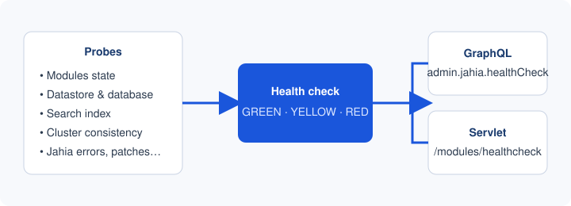

The Server Availability Manager extends the GraphQL API of Jahia with server monitoring, server
availability and maintenance operations for complex containerized environments.

It provides:

- the status of the health check probes, served by GraphQL and by `/modules/healthcheck`;
- the critical background tasks that are running;
- the server load, as sessions and requests;
- a server shutdown command.

It replaces the Healthcheck module. A project that uses Healthcheck migrates to this module.

The [monitoring page of the Jahia Academy](https://academy.jahia.com/documentation/jahia-cms/jahia-8.2/system-administrator/monitoring-your-jahia-servers)
documents the probes and their configuration.

## Versions

- [3.7.0](store/3.7.0)
- [3.6.0](store/3.6.0)
- [3.5.0](store/3.5.0)
- [3.4.1](store/3.4.1)
- [3.3.0](store/3.3.0)
- [3.2.1](store/3.2.1)
- [3.2.0](store/3.2.0)
- [3.1.0](store/3.1.0)
- [3.0.0](store/3.0.0)
- [2.9.0](store/2.9.0)
- [2.8.1](store/2.8.1)
- [2.8.0](store/2.8.0)
- [2.7.0](store/2.7.0)
- [2.6.0](store/2.6.0)
- [2.4.0](store/2.4.0)
- [2.3.0](store/2.3.0)
- [2.2.0](store/2.2.0)
- [2.1.0](store/2.1.0)
- [2.0.1](store/2.0.1)
- [2.0.0](store/2.0.0)
- [1.2.0](store/1.2.0)
- [1.1.0](store/1.1.0)
- [1.0.1](store/1.0.1)
- [1.0.0](store/1.0.0)

## Tabs

- [Installation](store/installation.md)
- [License](store/license.md)
